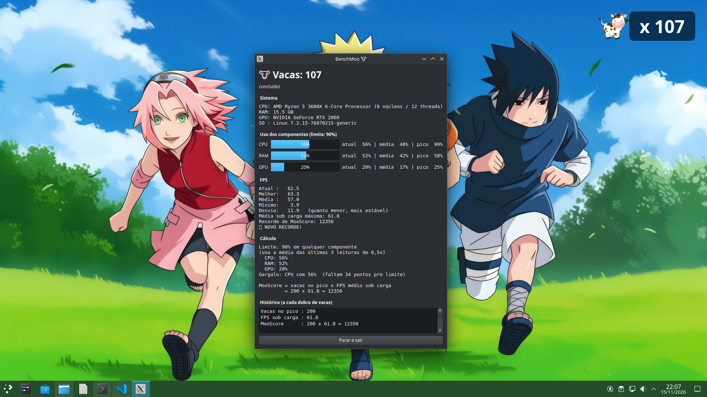

# BenchMoo


Você já imaginou fazer um benchmark com vacas? provavelmente não, por isso que eu criei o projeto! 

# MooScore

Agora é possível uploadar seus resultados! tem ranking, upload e muito mais!

disponível em:

```site
https://pixelcatbr.github.io/MooScore/
```

# Funcionalidades

O BenchMoo inclui várias funcionalidades como:

- MooScore: um sistema de pontuação próprio para o site do MooScore
- Monitoramento dos componentes: Ao chegar em 90% ele desliga
- contador de vacas: conta vacas, obviamente.
- Cálculo da média: calcula a média de desempenho.

# Aviso ⚠️ 
O monitoramento de GPU está disponível apenas para placas NVIDIA com nvidia-smi. Em placas de outras marcas, o BenchMoo continua funcionando normalmente, monitorando CPU e RAM.
# Licença

esse projeto usa a licença MIT. leia o arquivo de licença para mais detalhes.

# Como Instalar

## Linux
1. baixe o código fonte

2. instale as dependências com o comando a baixo:

```
pip install PyQt5 psutil
```
3. mova os arquivos para a raiz da sua pasta home
4. execute com o comando abaixo:

```
python3 main.py
```
## Windows

1. baixe o código fonte em formato zip

2. extraia o zip

3. execute o arquivo run.bat
